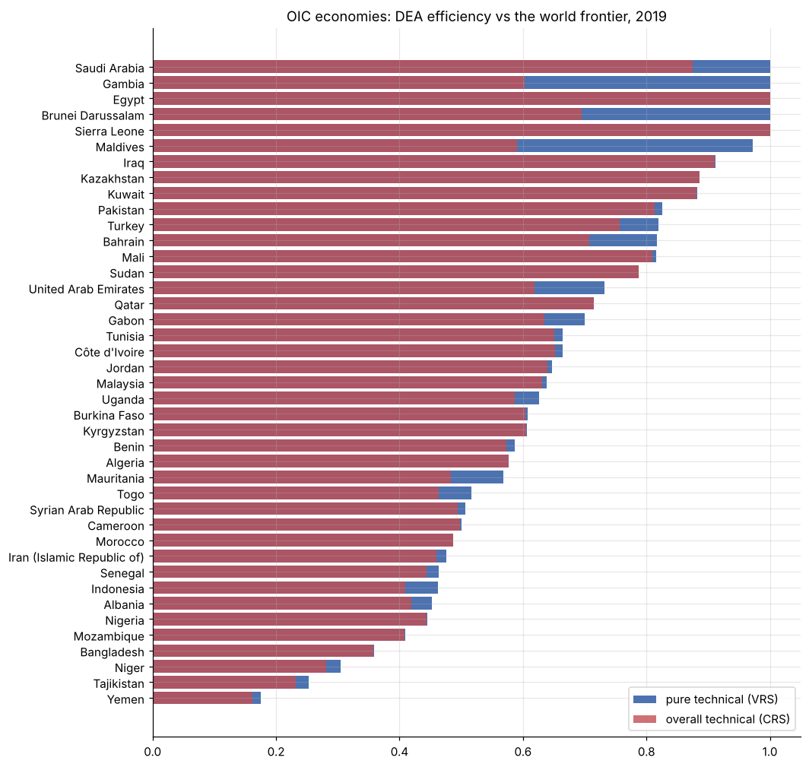
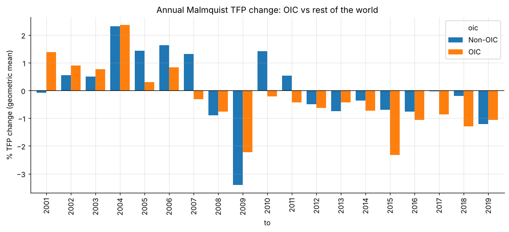
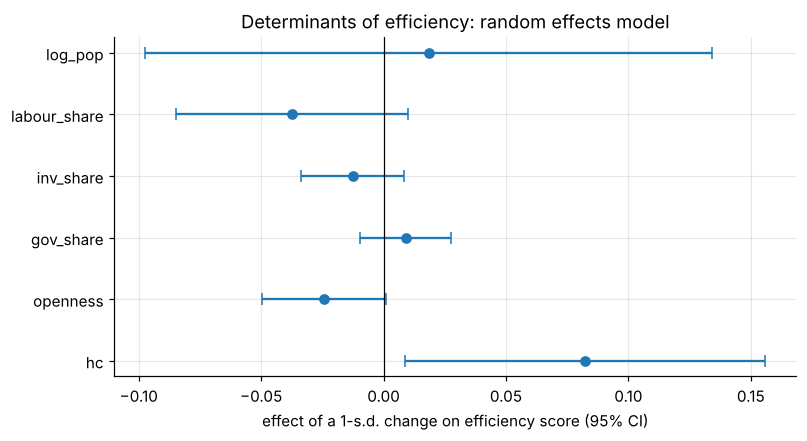

# DEA Efficiency & Panel Econometrics Toolkit

A tested Python toolkit for **efficiency and productivity analysis**: **Data Envelopment Analysis (CCR/BCC)**, **Malmquist productivity decomposition**, and **second-stage panel regressions** (pooled, fixed and random effects, robust Hausman, Breusch-Pagan LM, fractional logit). It is demonstrated on the economies of the **Organisation of Islamic Cooperation (OIC)** using the Penn World Table.



## Why this toolkit
It packages the methodology of my PhD research in finance (IIUM) on firm-level efficiency in OIC countries. There, DEA scores built from working-capital inputs (receivable, inventory and payable days) are related to performance and firm characteristics. The original research used licensed **Compustat Global** data, which cannot be redistributed, so this repository demonstrates the same pipeline on **public country-level data** and on a **simulated firm-level panel** that mirrors the Compustat design (`effpanel.synthetic`, notebook 04). Point the same functions at firm-level data to reproduce a firm-level study.

## What's inside

| Module | Methods |
|---|---|
| `effpanel.dea` | Envelopment-form DEA via linear programming (HiGHS): input/output orientation, CRS (CCR) and VRS (BCC), scale efficiency, benchmark peers |
| `effpanel.malmquist` | Malmquist TFP index with **efficiency-change (catch-up)** and **technical-change (frontier shift)** decomposition; chaining |
| `effpanel.panel` | Pooled OLS, entity and two-way fixed effects, random effects (clustered SEs); **robust Mundlak-Hausman** test; **Breusch-Pagan LM**; **Papke-Wooldridge fractional logit** |

## Notebooks & findings (OIC, 2000-2019)

| Notebook | Findings |
|---|---|
| [01 · DEA efficiency](notebooks/01_dea_efficiency_oic.ipynb) | Each country scored against a world frontier of 144 economies; rankings, benchmark peers and trends for Pakistan, Indonesia, Malaysia, Turkey, Egypt, Bangladesh, Nigeria and Saudi Arabia |
| [02 · Malmquist productivity](notebooks/02_malmquist_productivity.ipynb) | The world frontier shows technical *regress* after 2008; OIC economies caught up (+1.4%/yr) but more slowly than others (+2.0%/yr), so net TFP is about −0.3%/yr |
| [03 · Panel second stage](notebooks/03_panel_second_stage.ipynb) | Country effects matter (BP-LM); robust Hausman favours RE (p ≈ 0.06); **human capital** is the most robust positive correlate of efficiency |
| [04 · Firm panel: trade credit & intangibles](notebooks/04_trade_credit_firm_panel.ipynb) | The PhD firm-level design (Compustat Global, 24 OIC countries) run on a **simulated panel with known coefficients**: in-year winsorising and firm FE recover the planted effect, while pooled OLS overstates it about 4× and the robust Hausman test rejects RE. The WRDS extraction script for the real (licensed) data is included. Results on the real data for all 123 countries are in [global-firm-financials](https://github.com/drimranbhatti/global-firm-financials) |
| [05 · Panel models explained](notebooks/05_panel_models_explained.ipynb) | Pooled, between, FE, RE, first differences and mixed models on public panels: the union wage premium drops from 31% (between) to 8% (FE); training grants add about 34 hours per employee |

<p float="left">
  
  
</p>

## Quick start

```bash
git clone https://github.com/drimranbhatti/dea-panel-econometrics.git
cd dea-panel-econometrics
pip install -e ".[notebooks,dev]"
pytest                  # 7 tests
jupyter lab notebooks/
```

```python
from effpanel import dea, malmquist, panel
scores = dea.scale_efficiency(X_inputs, Y_outputs)                 # CRS, VRS, scale efficiency
tfp = malmquist.malmquist(long_df, ["capital", "labour"], ["gdp"])  # EC x TC decomposition
panel.hausman(panel_df, "score", ["hc", "openness"])               # robust FE vs RE test
```

## Validation
* Single-input/single-output CRS scores equal normalised productivity ratios, in both orientations
* Reproduces the two-input textbook example of Cooper, Seiford & Tone (2007)
* VRS ≥ CRS for every DMU; the Malmquist index equals 1 when nothing changes and recovers a known 10% frontier shift
* The robust Hausman test picks FE when effects are correlated with regressors and keeps about the nominal 5% size when RE is valid. The classical Hausman statistic can turn *negative* with clustered data, which is why the Mundlak form is used.

## Data
Penn World Table 10.01 (Feenstra, Inklaar & Timmer, 2015, *American Economic Review*), www.ggdc.net/pwt, licensed CC BY 4.0. Subset in `data/`. OIC membership list in `data/oic_members.csv`.

## References
Charnes, Cooper & Rhodes (1978) · Banker, Charnes & Cooper (1984) · Färe, Grosskopf, Norris & Zhang (1994) · Simar & Wilson (1998, 2007) · Mundlak (1978) · Hausman (1978) · Breusch & Pagan (1980) · Papke & Wooldridge (1996) · Wooldridge, *Econometric Analysis of Cross Section and Panel Data* (2010)

---
**Author:** Dr. Muhammad Imran Bhatti, PhD (Finance, IIUM), MScFE · FCMA · [LinkedIn](https://www.linkedin.com/in/drimranbhatti) · [imranbhatti.com](https://imranbhatti.com)

*MIT licensed (code). Data © their providers under their own licences.*
